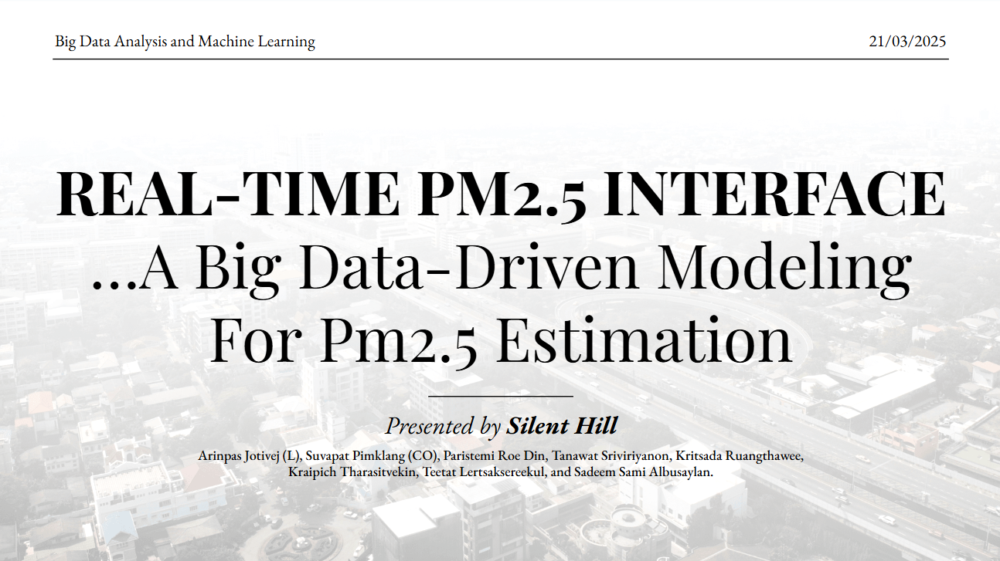

# Project Title

REAL-TIME PM2.5 INTERFACE
A Big Data-Driven Modeling For Pm2.5 Estimation

## Description

## overview of this project

To develop a mobile application for PM2.5 pollution that monitors real-time air quality, predicts future air quality (for the next 12 hours, 1 day, and 3 days), and provides actionable insights and recommendations through an interactive calculator. The application aims to improve the public health by encouraging protective measures, while also promoting sustainability through less harmful transportation choices.

## Authors

Arinpas Jotivej (L), Suvapat Pimklang (CO), Paristemi Roe Din, Tanawat Sriviriyanon, Kritsada Ruangthawee, Kraipich Tharasitvekin, Teethut Lertsaksereekul, and Sadeem Sami Albusaylan,
